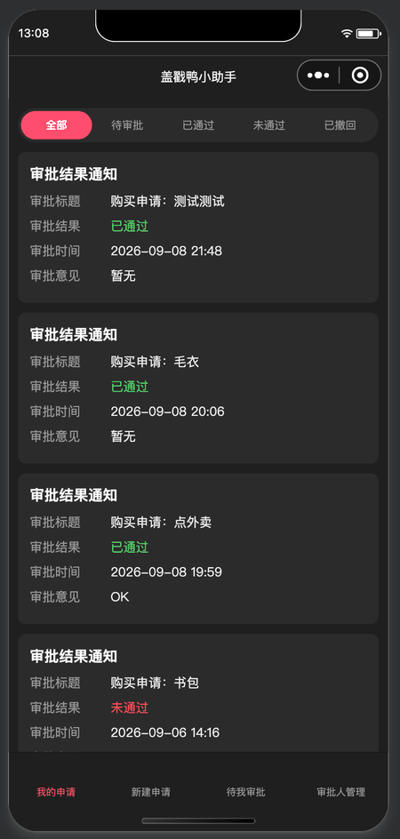
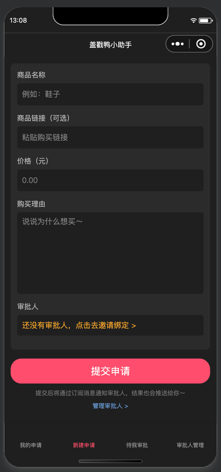
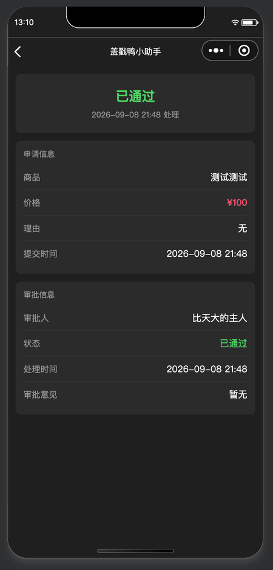
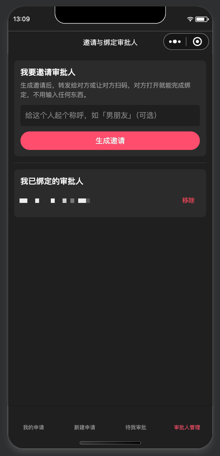

# 盖戳鸭小助手 · 购买申请审批小程序

一个给情侣 / 家人用的微信小程序：**想买东西 → 提交申请 → 对方审批 → 结果推送到微信**。
基于**微信云开发**（云函数 + 云数据库 + 订阅消息），不需要自建服务器。

> **English summary** — A WeChat mini program for couples and families: submit a purchase request, let your partner approve or reject it, and get notified through subscription messages. Built entirely on WeChat Cloud Development (serverless). Features invite-based pairing (share card / mini-program QR code), request withdraw & re-edit, and cloud functions guarded by identity checks and a small status state machine.

## 项目背景

朋友们觉得家庭场景下用一个小程序来「审批」购物很有意思，于是我着手把它做了出来。

它的初衷不是管钱，而是**在下单前多加一步**：提交申请时要写下买什么、多少钱、为什么想买，再等家人确认。这一步本身就是让人停下来想一想「我是不是真的需要它」，从而减少冲动消费。

| 项目 | 说明 |
|---|---|
| 周期 | 约 2–3 周：核心开发约 2 周，其余时间用于测试和功能调整 |
| 我的角色 | 独立负责需求定义、范围规划、流程设计、测试验收、版本发布与文档；代码在 AI 辅助下完成（见下方「开发方式」） |
| 测试 | 5–6 位真实用户参与体验版试用，覆盖申请人和审批人两种角色；每次改动后由我自己跑一轮完整流程测试 |
| 范围 | 聚焦核心闭环：邀请绑定 → 提交申请 → 审批 → 消息通知，以及撤回与重新编辑 |
| 刻意不做 | **支付**和**多级审批**：小程序不涉及真实的金钱往来，加入这些功能会让平台审核更严格，也偏离了「帮人冷静想一想」的初衷 |
| 状态 | 体验版核心流程已跑通，尚未正式发布 |

## 开发方式

这个项目的代码是在 AI（Claude）的辅助下完成的。我把 AI 当作研发资源来管理，自己负责「做什么、做到什么程度、怎么验收」：

| 我负责 | AI 负责 |
|---|---|
| 需求定义、范围取舍、交互流程设计 | 代码实现 |
| 分阶段验收，每次改动后自己跑一轮完整流程测试 | 技术方案建议 |
| 问题复现与定位、决定修复优先级 | 排错辅助 |
| 版本发布、代码与文档管理 | |

过程中的几个例子：

- **邀请小程序码生成失败**：前端只提示「生成失败」，实际是部署、权限、版本、参数校验四层问题叠在一起。我坚持一次只修一层、每一步都看日志确认，而不是凭猜测改代码。完整过程记录在 [DEBUG-NOTES](docs/DEBUG-NOTES.md)。
- **云函数依赖缺失**：部署后报 `Cannot find module 'wx-server-sdk'`，排查后确认是云端安装依赖失败，改为本地安装后全量上传，并把处理方法写进部署说明。
- **公开代码前的安全处理**：上传 GitHub 前，把云环境 ID、订阅消息模板 ID 等账号信息从代码中抽离到不入库的配置文件，仓库里只保留示例文件。
- **已知问题的处理**：测试中发现审批人侧的订阅授权弹窗没有按预期出现，记录为已知问题，列入后续计划，而不是在没定位清楚前仓促修改。

## 功能

| 模块 | 说明 |
|---|---|
| 邀请绑定 | 申请人生成邀请 → 用**转发卡片**或**小程序码**发给对方 → 对方打开后填个称呼确认绑定，全程不用输入邀请码 |
| 审批人管理 | 一个申请人可以绑定多个审批人，随时可移除 |
| 提交申请 | 商品名称、链接、价格、理由，并选择审批人 |
| 审批 | 审批人在「待我审批」里通过 / 驳回，可写审批意见 |
| 我的申请 | 按状态筛选：全部 / 待审批 / 已通过 / 未通过 / 已撤回 |
| 撤回与编辑 | 待审批的申请可以撤回；已撤回的申请可以编辑后重新提交（覆盖原记录，重新变回待审批） |
| 详情页 | 状态卡片、审批意见，待审批时可一键转发给审批人 |
| 微信推送 | 新申请 → 通知审批人；审批结果 → 通知申请人（订阅消息） |

## 界面预览

| 我的申请 | 新建申请 | 申请详情 | 审批人管理 |
|:---:|:---:|:---:|:---:|
|  |  |  |  |
| 按状态筛选，查看每条申请的审批结果 | 填写商品、价格、理由并选择审批人 | 状态卡片 + 申请信息 + 审批信息 | 生成邀请、管理已绑定的审批人 |

> 截图来自微信开发者工具模拟器，「审批人管理」页中的审批人昵称已打码。

## 技术栈

- 微信小程序原生框架
- 微信云开发：云函数（Node.js 16，`wx-server-sdk ~2.6.3`）、云数据库、云存储
- 微信开放能力：订阅消息、小程序码（`wxacode.getUnlimited`）

## 目录结构

```
purchase-approval/
├── miniprogram/                 # 小程序前端
│   ├── app.js / app.json        # 云开发初始化 / 页面与 tabBar 配置
│   └── pages/
│       ├── list/                # 我的申请（tab）
│       ├── apply/               # 新建 / 编辑申请（tab）
│       ├── approve/             # 待我审批（tab）
│       ├── invite/              # 审批人管理：邀请、绑定、移除（tab）
│       └── detail/              # 申请详情
├── cloudfunctions/              # 云函数
│   ├── createInvite/            # 生成邀请（写 relationships）
│   ├── getInviteQrcode/         # 生成邀请小程序码
│   ├── bindInvite/              # 对方确认绑定
│   ├── getMyApprovers/          # 查询我已绑定的审批人
│   ├── unbindApprover/          # 申请人移除审批人
│   ├── submitApply/             # 提交申请 + 通知审批人
│   ├── getApplies/              # 按角色查询申请列表
│   ├── doApprove/               # 审批 + 通知申请人
│   ├── withdrawApply/           # 撤回申请
│   └── editApply/               # 编辑已撤回的申请并重新提交
└── docs/
    ├── ARCHITECTURE.md          # 架构、数据模型、设计取舍
    ├── DEBUG-NOTES.md           # 踩坑与排查记录
    ├── USER-GUIDE.md            # 使用说明 / 测试流程
    └── screenshots/             # README 里用到的界面截图
```

## 快速开始

### 1. 填写配置

和个人账号绑定的值都放在单独的配置文件里，这些文件不入库（见 `.gitignore`）。仓库里提交的是对应的 `config.example.js`，克隆后复制一份改名为 `config.js`，再填入你自己的值：

| 文件（从 `config.example.js` 复制） | 要填的值 | 从哪里获取 |
|---|---|---|
| `miniprogram/config.js` | 云环境 ID、两个订阅消息模板 ID | 云开发控制台 → 环境 ID；订阅消息 → 我的模板 |
| `cloudfunctions/submitApply/config.js` | 「待办事项提醒」模板 ID | 订阅消息 → 我的模板 |
| `cloudfunctions/editApply/config.js` | 「待办事项提醒」模板 ID | 同上 |
| `cloudfunctions/doApprove/config.js` | 「审核结果通知」模板 ID | 同上 |

AppID：把 `project.config.json` 里的 `YOUR_APPID` 换成你自己的（公众平台 → 开发管理 → 开发设置）。

> 云函数里的 `config.js` 会随云函数一起上传，所以部署时要选「上传并部署：所有文件」，或确保该文件在上传范围内。

### 2. 开通云开发并建集合

新建两个数据库集合：`relationships`、`applies`（字段由云函数写入，不用手动建）。

| 集合 | 权限设置 | 原因 |
|---|---|---|
| `relationships` | 客户端不可读写（仅云函数） | 前端只通过云函数访问它 |
| `applies` | 客户端可读、不可写 | 详情页、编辑页目前在前端直接读取，所有写入都走云函数（见「已知限制」） |

### 3. 部署云函数

在开发者工具里，对 `cloudfunctions/` 下的每个云函数右键 →「上传并部署：云端安装依赖」。

> 如果调用时报 `Cannot find module 'wx-server-sdk'`：在该云函数目录执行 `npm install`，然后改用「上传并部署：所有文件」。原因和排查过程见 [DEBUG-NOTES](docs/DEBUG-NOTES.md)。

`cloudfunctions/getInviteQrcode/config.json` 用来声明云调用权限（`wxacode.getUnlimited`），请勿删除。

### 4. 选用订阅消息模板

在公众平台「订阅消息 → 公共模板库」选用下面两个模板。**关键词的选择顺序决定字段顺序**，请按表格顺序选；如果选了别的关键词，需要同步修改云函数里 `data` 的字段名。模板的服务类目需要和你小程序已设置的类目匹配（本项目用的两个模板类目都是「记账」）。

| 用途 | 模板 | 关键词（按顺序） | 代码里用到的字段名 |
|---|---|---|---|
| 通知审批人 | 待办事项提醒 | 事项名称、金额、提醒内容、创建日期 | `thing10` `amount17` `thing2` `time9` |
| 通知申请人 | 审核结果通知 | 申请内容、报单金额、审批结果、审核意见、审核时间 | `thing7` `amount8` `phrase4` `thing9` `time5` |

字段名以你「我的模板」详情页里显示的为准。

### 5. 上传并在手机上测试

1. 开发者工具点「上传」→ 公众平台「版本管理」→ 把该版本「选为体验版本」
2. 把测试的人加进「成员管理」里的体验成员
3. 每次改完代码，想让手机上生效，都要重新上传并重新设为体验版
4. 订阅消息和转发都需要用**真机**测试

正式发布前，把 `getInviteQrcode/index.js` 里的 `env_version: 'trial'` 改成 `'release'`，并去掉 `check_path: false`。

## 已知限制与后续计划

- 页面是固定深色配色，还没有适配「跟随系统」的深色 / 浅色模式
- 审批人一侧暂时不能主动解除关系，也看不到「我在为谁审批」的列表
- 详情页、编辑页在前端直接读取 `applies`，要求集合对客户端可读；计划改成云函数校验身份后再返回
- `submitApply` 没有校验所选审批人是否真的是当前用户已绑定的人
- 订阅消息是一次性订阅：每次授权只能收到一条；审批人侧的授权弹窗触发逻辑还在排查
- 邀请小程序码会写入云存储，暂时没有清理机制
- `applies` 里 `createTime` 是服务端日期对象、`approveTime` 是毫秒时间戳，类型不统一

更详细的设计取舍见 [ARCHITECTURE](docs/ARCHITECTURE.md)。

## 许可证

暂未指定。
