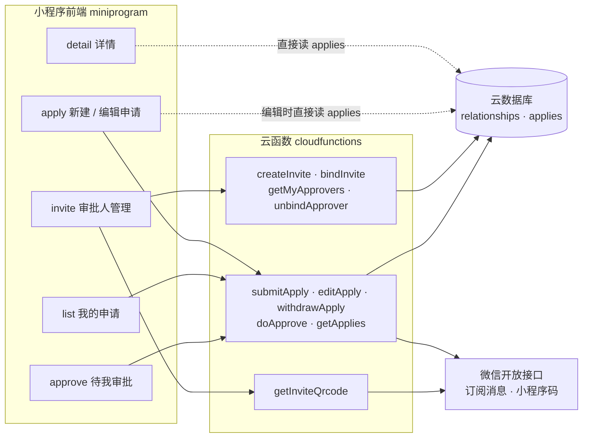
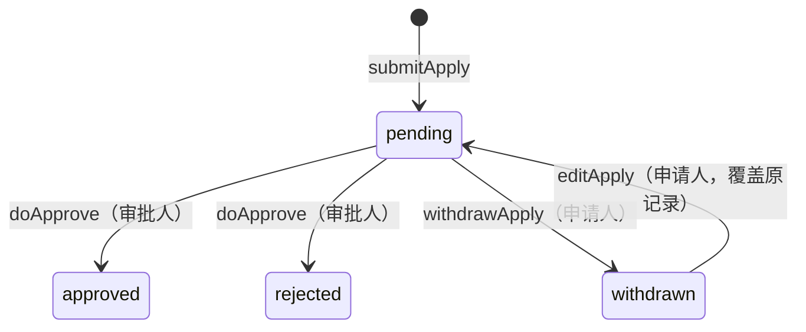

# 架构与设计说明

## 1. 总览

前端页面绝大多数操作都通过云函数完成，只有详情页和编辑页会在前端直接读取 `applies`（见「已知限制」）。

## 2. 数据模型

### `relationships`：谁可以审批谁

| 字段 | 类型 | 说明 |
|---|---|---|
| `ownerOpenId` | string | 邀请发起人（也就是申请人）的 openid |
| `inviteCode` | string | 6 位一次性邀请码，字符集去掉了 0 / O / I / 1 / L 这类易混淆字符 |
| `relationLabel` | string | 发起人给对方起的称呼，可为空 |
| `approverOpenId` | string \| null | 绑定后的审批人 openid |
| `approverName` | string | 审批人自己填的称呼 |
| `status` | `pending` \| `bound` | 待绑定 / 已绑定 |
| `createTime` | Date | 创建时间（服务端时间） |
| `bindTime` | Date | 绑定时间 |

### `applies`：一次具体的购买申请

| 字段 | 类型 | 说明 |
|---|---|---|
| `title` | string | 商品名称 |
| `link` | string | 商品链接，可为空 |
| `price` | number | 价格 |
| `reason` | string | 购买理由 |
| `applicantOpenId` | string | 申请人 |
| `approverOpenId` | string | 审批人 |
| `approverName` | string | 提交时的审批人称呼（快照） |
| `status` | `pending` \| `approved` \| `rejected` \| `withdrawn` | 申请状态 |
| `comment` | string | 审批意见 |
| `approveTime` | number \| null | 审批时间戳（毫秒） |
| `createTime` | Date | 提交时间；编辑后重新提交会刷新 |

## 3. 申请状态机

每个会改变状态的云函数都做两道守卫：**身份**（调用者的 openid 必须和记录里的对应角色一致）和**前置状态**（只允许从特定状态出发）。

| 云函数 | 身份校验 | 允许的前置状态 |
|---|---|---|
| `doApprove` | `approverOpenId` == 调用者 | `pending` |
| `withdrawApply` | `applicantOpenId` == 调用者 | `pending` |
| `editApply` | `applicantOpenId` == 调用者 | `withdrawn` |
| `unbindApprover` | `ownerOpenId` == 调用者 | 无（直接删除这条关系） |
| `bindInvite` | 无（凭邀请码） | 关系的 `status` 为 `pending` |

## 4. 关键设计与取舍

### 4.1 关系和申请分成两个集合

- **问题**：「谁可以审批谁」是长期存在的关系，「一次购买申请」是一次性事件，两者生命周期不同。如果申请只引用关系，一旦关系被移除，历史申请就找不到审批人了。
- **方案**：分成 `relationships` 和 `applies` 两个集合。提交申请时，把 `approverOpenId`、`approverName` 冗余写进申请记录（快照）。之后的审批、撤回、编辑、列表，都只依赖 `applies`。
- **取舍**：有一点数据冗余，审批人以后改称呼不会同步到历史申请；移除审批人也不会影响已经提交的申请，这是有意为之。代价是 `submitApply` 目前信任前端传来的审批人，没有回查关系表（见「已知限制」）。

### 4.2 邀请：一次性邀请码 + 两种触达方式

- **问题**：让对方手动输入一串邀请码，对不爱折腾的人来说太麻烦。
- **方案**：邀请码仍然是底层凭证（一次性，`pending → bound`），但不再展示给用户。
  - 转发卡片：`onShareAppMessage` 的 path 里带 `?code=xxx`
  - 小程序码：`wxacode.getUnlimited`，把邀请码放在 `scene` 里
  - invite 页的 `onLoad` 统一解析 `options.code` 或 `decodeURIComponent(options.scene)`，自动填好，用户只需要确认称呼
- **取舍**：去掉手动输入入口之后，「绑定」区域只会在通过邀请链接进入时出现；小程序码的生成依赖云函数权限声明、体验版设置等，踩坑记录见 [DEBUG-NOTES](DEBUG-NOTES.md)；生成的图片写入云存储，目前没有清理机制。

### 4.3 身份只信任服务端

云函数一律使用 `cloud.getWXContext().OPENID` 作为调用者身份，不采用前端传来的身份字段。撤回、编辑、审批、解绑都是先取记录、再比对归属和状态，最后才写库。

唯一的例外是 `submitApply` 里的 `approverOpenId` 来自前端，这是待加固的点。

### 4.4 订阅消息是"尽力而为"，先写库再通知

- **问题**：订阅消息是一次性订阅，用户每同意一次才能收一条；用户可能拒绝，推送接口也可能失败。
- **方案**：
  - 业务写库在前，推送在后，并且包在 `try/catch` 里；推送失败只记 `console.warn`，不影响主流程的返回
  - 授权时机：申请人在提交前（apply 页）请求「审核结果」模板；审批人每次进入「待我审批」页（approve 页 `onShow`）请求「新申请」模板
  - 详情页提供「转发给审批人」作为兜底
- **取舍**：通知不保证送达；每次 `onShow` 都请求授权，可能对用户有打扰。

### 4.5 tabBar 页面之间的传参

`apply` 是 tabBar 页面，`wx.switchTab` 不支持 query 参数。编辑模式改用 `app.globalData.editApplyId` 一次性传递：apply 页 `onShow` 读取后立即清空。

复用同一个表单页来做编辑，而不是另建一个编辑页，可以减少重复代码；代价是页面里要区分新建 / 编辑两种模式（`editMode`），并且要小心一次性标志的消费时机。

### 4.6 编辑已撤回的申请：覆盖原记录

- 选择**覆盖原记录并重置为 `pending`**，而不是新建一条：列表里不会出现两条重复的申请。
- 代价：撤回前的内容不保留历史；重新提交会刷新 `createTime`，并再次通知审批人。

### 4.7 撤回和编辑的状态边界

撤回只允许 `pending`，编辑只允许 `withdrawn`。已经通过 / 未通过的申请不能被改动，避免出现「审批结论和申请内容对不上」的情况。

## 5. 已知限制

| 问题 | 影响 | 可能的改进 |
|---|---|---|
| 详情页、编辑页前端直接读 `applies` | 集合需要对客户端可读，理论上其他用户也能查询到别人的申请 | 新增云函数，校验 openid 是申请人或审批人后再返回 |
| `submitApply` 不校验 `approverOpenId` | 可以向任意 openid 发起申请 | 提交时回查 `relationships`，确认存在 `bound` 关系 |
| 邀请小程序码写入云存储且不清理 | 存储文件会慢慢累积 | 定时清理，或者改成邀请被使用后删除 |
| `createTime` 与 `approveTime` 类型不一致 | 前端要分别格式化 | 统一用服务端时间或统一用毫秒时间戳 |
| 订阅消息是一次性授权 | 用户没授权或授权已被消耗就收不到 | 长期订阅模板，或者继续用转发作为兜底 |
| 无深色 / 浅色跟随 | 固定深色配色 | 使用 `theme.json` 和 CSS 变量适配 |
